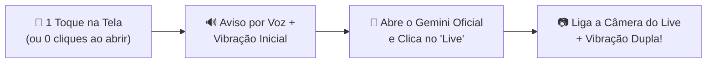

<div align="center">

# 👁️ Olhos da Vó (`vo-click`)
### Gemini Live + Câmera em 1 Clique para Pessoas com Baixa Visão

[](https://github.com/Gabriell-Ilius/vo-click/actions/workflows/build-apk.yml)
[](https://github.com/Gabriell-Ilius/vo-click/releases/latest)
[-3DDC84?logo=android&logoColor=white)](https://developer.android.com)
[](LICENSE)

Aplicativo Android gratuito e de código aberto criado para ajudar idosos e pessoas com deficiência visual severa ("quase cegas") a usarem o **Google Gemini Live com Câmera** como seus olhos — **sem precisar enxergar botões pequenos e sem custos de API**.

</div>

---

## ✨ Como Funciona

Normalmente, para mostrar algo pela câmera ao Gemini Live, a pessoa precisa abrir o app do Gemini, procurar o botão pequeno do modo **Live**, aguardar conectar e depois procurar o botão da **Câmera**. Para quem tem baixa visão severa, isso é uma barreira.

O **Olhos da Vó** resolve isso transformando **a tela inteira do celular em um único botão gigante** (ou iniciando direto ao tocar no ícone do aplicativo):



1. **Alto Contraste Total:** Fundo preto (`#000000`) com bordas e letras gigantes em amarelo (`#FFD600`).
2. **Feedback por Voz e Tato:** Ao tocar em qualquer ponto da tela, o celular vibra e fala em português: *"Abrindo câmera do Gemini, aguarde."*
3. **Automação Inteligente (`AccessibilityService`):** Abre o aplicativo oficial gratuito do **Google Gemini**, clica sozinho no botão **Live** e, assim que conecta, clica sozinho no botão de **Ativar Câmera**.
4. **Confirmação na Mão:** Quando a câmera está aberta e pronta, o celular dá **duas vibrações curtas**, avisando que ela já pode apontar o celular e conversar com o Gemini.
5. **Proteção contra Toques Acidentais:** O menu de configurações da família só abre **segurando o dedo por 2 segundos** no canto superior direito. Se ela esbarrar ali com um toque normal, o app também abre o Gemini Live normalmente!

---

## 📥 Download Direto do Aplicativo (`.APK`)

Você não precisa instalar o Android Studio para gerar o aplicativo. O próprio GitHub compila e publica o instalador automaticamente a cada atualização:

1. No celular Android, acesse a página de **[Releases (Versões Prontas)](https://github.com/Gabriell-Ilius/vo-click/releases/latest)**.
2. Na seção **Assets**, toque no arquivo **`OlhosDaVo.apk`** para baixar e instalar.
3. Siga o **[📱 Guia Passo a Passo de Instalação para a Família](docs/GUIA_INSTALACAO_FAMILIA.md)** para ativar a permissão de Acessibilidade na primeira vez.

---

## 🗂️ Organização do Repositório

```text
vo-click/
├── .github/workflows/
│   └── build-apk.yml                        # Compila o APK na nuvem e publica em Releases
├── app/
│   ├── build.gradle.kts                     # Configuração de build do módulo Android
│   └── src/main/
│       ├── AndroidManifest.xml              # Permissões, Queries (Android 11+) e Serviços
│       ├── java/com/olhosdavo/geminilive/
│       │   ├── data/
│       │   │   └── PrefsManager.kt          # Preferências salvas e coordenadas de fallback
│       │   ├── service/
│       │   │   └── GeminiLiveAccessibilityService.kt # Motor de automação (Live + Câmera)
│       │   ├── ui/
│       │   │   ├── MainActivity.kt          # Tela de botão gigante para a avó
│       │   │   └── SettingsActivity.kt      # Painel de ajuste para familiares
│       │   └── util/
│       │       ├── FeedbackHelper.kt        # Voz (TTS pt-BR) e alertas de vibração
│       │       └── GeminiLauncher.kt        # Abertura do app oficial Google Gemini
│       └── res/
│           ├── drawable/                    # Ícones e bordas de alto contraste
│           ├── layout/                      # Interfaces XML (Tela da Avó e Configurações)
│           ├── values/                      # Textos e Tema escuro acessível
│           └── xml/                         # Configuração do AccessibilityService
├── docs/
│   ├── GUIA_INSTALACAO_FAMILIA.md           # Passo a passo para configurar no celular dela
│   └── ARQUITETURA.md                       # Documentação técnica do funcionamento interno
├── build.gradle.kts                         # Configuração raiz do Gradle
├── settings.gradle.kts                      # Definição do projeto OlhosDaVo
└── README.md                                # Apresentação do projeto
```

---

## 🛠️ Compilando Localmente (Opcional)

Caso queira abrir e modificar o projeto no seu computador:
1. Clone o repositório:
   ```bash
   git clone https://github.com/Gabriell-Ilius/vo-click.git
   ```
2. Abra a pasta no **Android Studio** (JDK 17 / Android SDK 34).
3. Vá no menu **Build → Build Bundle(s) / APK(s) → Build APK(s)**.

---

## 📚 Documentação Adicional

* **[📱 Guia de Instalação para a Família](docs/GUIA_INSTALACAO_FAMILIA.md)** — Inclui a dica de como liberar a *"Configuração restrita"* no Android 13, 14 e 15.
* **[🏗️ Arquitetura Técnica](docs/ARQUITETURA.md)** — Explica como a árvore de nós de acessibilidade e o *fallback* de gestos funcionam.
