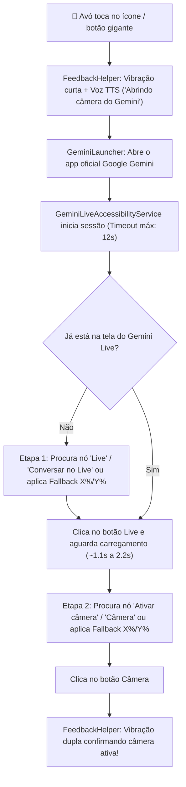

# 🏗️ Arquitetura Técnica — Olhos da Vó (`vo-click`)

Este documento descreve como o aplicativo **Olhos da Vó** foi estruturado para automatizar a abertura do **Google Gemini Live + Câmera** de forma segura, rápida e acessível no Android.

---

## Fluxo de Funcionamento

---

## Organização de Pacotes (`com.olhosdavo.geminilive`)

| Pacote / Arquivo | Responsabilidade |
| :--- | :--- |
| **`ui/MainActivity.kt`** | Interface principal de alto contraste (Preto `#000000` e Amarelo `#FFD600`). Ocupa 100% da tela como área clicável e protege o acesso às configurações por toque longo (`OnLongClickListener`). |
| **`ui/SettingsActivity.kt`** | Painel de configuração exclusivo para familiares (status da acessibilidade, atalho para liberar Configuração Restrita no Android 13+, modo 0-cliques e calibração de coordenadas X%/Y%). |
| **`service/GeminiLiveAccessibilityService.kt`** | Máquina de estados (`IDLE` → `STEP_1_OPEN_LIVE` → `STEP_2_OPEN_CAMERA`) que combina eventos de acessibilidade (`onAccessibilityEvent`) com *polling* ativo a cada `350ms` para detectar janelas sobrepostas do Gemini. |
| **`data/PrefsManager.kt`** | Persistência leve via `SharedPreferences` das preferências de voz, auto-início e coordenadas de *fallback*. |
| **`util/FeedbackHelper.kt`** | Gerencia síntese de voz nativa (`TextToSpeech` em `pt-BR`) e padrões de vibração (`VibrationEffect`). |
| **`util/GeminiLauncher.kt`** | Resolve a abertura do aplicativo oficial do Google Gemini tentando `com.google.android.apps.bard`, `ACTION_ASSIST`, `ACTION_VOICE_COMMAND` e `com.google.android.googlequicksearchbox`. |

---

## Estratégia Dupla de Clique (Árvore de Nós + Gesto Físico)

Aplicativos modernos do Google utilizam componentes híbridos (Views nativas + Jetpack Compose). Por isso, o `GeminiLiveAccessibilityService` implementa três camadas de segurança para nunca falhar no clique:

1. **Busca Semântica na Árvore (`searchNodeTree`):** Varre todas as janelas interativas (`windows` e `rootInActiveWindow`), normalizando acentos e buscando por `contentDescription`, `text` e `viewIdResourceName`.
2. **Ação de Clique + Toque nas Bordas (`clickNodeOrTapBounds`):** Tenta executar `ACTION_CLICK` no nó ou em até 5 níveis de pais clicáveis; caso o componente não aceite `ACTION_CLICK`, calcula o centro geométrico (`Rect.centerX()`, `Rect.centerY()`) do botão encontrado e injeta um toque real via `dispatchGesture`.
3. **Fallback de Coordenadas (`tapScreenPercent`):** Se em algum aparelho específico o botão for puramente gráfico sem rótulo de texto, o serviço realiza o toque na porcentagem `X%` e `Y%` da tela (ajustável pela família na tela de configurações).
